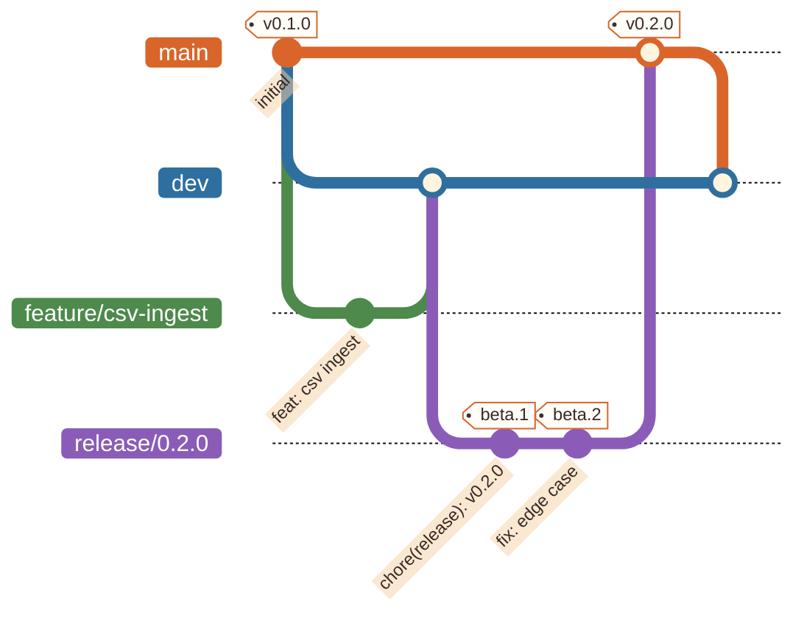

# Contributing to mallops

Thanks for your interest! Read [docs/SPEC.md](https://bighands2304.github.io/mallops/latest/SPEC/) and [docs/ARCHITECTURE.md](https://bighands2304.github.io/mallops/latest/ARCHITECTURE/) first.

## Branches



| Branch | From | Into | Merge style |
|---|---|---|---|
| `feature/*`, `fix/*`, `docs/*` | `dev` | `dev` | squash |
| `release/X.Y.Z` | `dev` (via *Start release* workflow) | `main` | merge commit |
| `hotfix/X.Y.Z` | `main` | `main` | merge commit |
| back-merge PR | `main` | `dev` | merge commit |

- `main` contains only released versions; `dev` is the default branch.
- Each push on `release/*` publishes a pre-release `vX.Y.Z-beta.N`.
- A `hotfix/*` branch must bump the patch version in `Cargo.toml` and update `CHANGELOG.md`.

## Commits and PR titles

PRs are squash-merged, so the **PR title** becomes the commit and must follow [Conventional Commits](https://www.conventionalcommits.org):
`feat(core): add artifact store`, `fix(cli): …`, `docs: …`, `refactor: …`, `test: …`, `ci: …`, `build: …`, `chore: …`.
Breaking changes: `feat!: …` or a `BREAKING CHANGE:` footer.

## Developer Certificate of Origin (DCO)

Every commit must be signed off, certifying that you wrote it or otherwise have the right to submit it under the project license, as stated in the [Developer Certificate of Origin](https://developercertificate.org). The sign-off is a trailer matching the commit author:

```
Signed-off-by: Jane Doe <jane@example.com>
```

Add it with `git commit -s`. To fix commits already in a PR:

```sh
git rebase --signoff origin/dev        # adds the trailer to every commit of the branch
git push --force-with-lease
```

The `dco` CI job blocks PRs with unsigned commits and rejects merge commits in feature PRs (rebase onto `dev` instead; verified `dependabot[bot]`/`github-actions[bot]` commits and verified GitHub merge commits in release/back-merge PRs are exempt). Squash merges keep all trailers in the final commit.

## Local checks

```sh
cargo fmt --all
cargo clippy --workspace --all-targets --all-features -- -D warnings
cargo test --workspace --all-features
```

## Documentation

The site is built with [MkDocs Material](https://squidfunk.github.io/mkdocs-material/) from `docs/` and published on GitHub Pages, versioned with [mike](https://github.com/jimporter/mike): `/dev/` follows the `dev` branch, `/X.Y/` is published at each release, `/latest/` points to the newest stable one.

```sh
pip install -r docs/requirements.txt
mkdocs serve          # live preview on http://127.0.0.1:8000
mkdocs build --strict # what CI runs on PRs
```

The Rust API reference is generated by rustdoc and hosted on [docs.rs](https://docs.rs/mallops-core).

## Releasing (maintainers)

1. Actions → **Start release** → choose `patch|minor|major`. This opens `release/X.Y.Z` → `main` and publishes `vX.Y.Z-beta.1`.
2. Test the beta; push fixes to the release branch (each push = new beta).
3. Merge the PR with **Create a merge commit**. The tag, GitHub Release, binaries and crates.io publish happen automatically.
4. Merge the auto-opened back-merge PR into `dev` (merge commit).

Required secrets: `RELEASE_TOKEN` (repository secret, fine-grained PAT or GitHub App token with contents + pull-requests write, so bot-created branches/PRs trigger CI) and `CARGO_REGISTRY_TOKEN` (in the `release` environment, for crates.io).

## Architecture changes

Significant design changes need an ADR in [docs/adr/](https://bighands2304.github.io/mallops/latest/adr/) submitted with or before the implementation.

## License

By contributing you agree your contributions are licensed under the [Apache-2.0](https://github.com/bighands2304/mallops/blob/dev/LICENSE) license.
