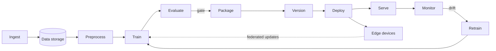

<p align="center">
  <picture>
    <source media="(prefers-color-scheme: dark)" srcset="docs/assets/mallops-logo-dark.svg">
    
  </picture>
</p>

<h1 align="center">mallops</h1>

<p align="center">
  <b>Modular MLOps in Rust — from data ingestion to edge devices, one block at a time.</b>
</p>

<p align="center">
  <a href="https://github.com/bighands2304/mallops/actions/workflows/ci.yml"></a>
  <a href="LICENSE"></a>
  <a href="https://crates.io/crates/mallops-core"></a>
  
</p>

---

> ⚠️ **Early stage.** mallops is in the design phase. The specification and architecture are open for feedback — see [docs/SPEC.md](docs/SPEC.md).

## Why mallops

- **Every MLOps step is a block** — ingestion, data storage, preprocessing, training, model engineering, evaluation, packaging, versioning, deploy, serving, monitoring, retrain. Add, remove or replace any of them.
- **Bring any model, any library** — ONNX, safetensors, TorchScript, pickle, GGUF, XGBoost, your own format. Train in Rust, Python, or anything that runs in a process.
- **Three ways to use it** — as a Rust library, with plugins (WASM or external processes in any language), or standalone with a YAML file and the `mallops` CLI.
- **Edge-ready** — local serving, distributed monitoring and federated learning on devices (planned v0.4).
- **Reproducible** — content-addressed artifacts, lineage for every run, cached re-runs.

## A pipeline at a glance

```yaml
version: 1
name: churn-classifier
blocks:
  raw:      { use: std/ingest.csv, with: { path: data/customers.csv } }
  features: { use: std/preprocess.tabular, in: { data: raw.dataset },
              with: { target: churned, steps: [{ split: { test: 0.2, seed: 42 } }] } }
  model:    { use: std/external, in: { train: features.train },
              with: { command: [python, ./train.py], inputs: { train: features }, outputs: { model: model }, flavor: sklearn-pickle } }
  eval:     { use: std/evaluate.classification, in: { model: model.model, test: features.test },
              with: { gate: { metric: f1, min: 0.8 } } }
  package:  { use: std/package,
              in: { model: model.model, preprocess: features.transform, metrics: eval.metrics } }
serve:
  package: package.package
  port: 8080
```

```sh
mallops validate && mallops run && mallops serve --trust-unsafe-flavors
```



## Roadmap

| Version | Focus |
|---|---|
| v0.1 | Core runtime, YAML pipelines, CLI, local end-to-end pipeline (incl. data validation and batch inference) |
| v0.2 | Object stores, model registry & versioning, deploy, gRPC serving, WASM/gRPC plugins, experiment tracking, explainability, streaming |
| v0.3 | Monitoring, drift detection, retrain triggers, deep-learning training, remote execution |
| v0.4 | Edge agent, federated learning, fleet deploy |
| v1.0 | Stable API and plugin protocol |

## Documentation

📖 **[bighands2304.github.io/mallops](https://bighands2304.github.io/mallops/)** — full documentation site.

- [Technical specification](docs/SPEC.md)
- [Architecture](docs/ARCHITECTURE.md)
- [Architecture Decision Records](docs/adr/)

## Contributing

Contributions are welcome! Read [CONTRIBUTING.md](CONTRIBUTING.md) for the branching model and commit conventions. Please follow our [Code of Conduct](CODE_OF_CONDUCT.md).

## License

Licensed under the [Apache License, Version 2.0](LICENSE).
