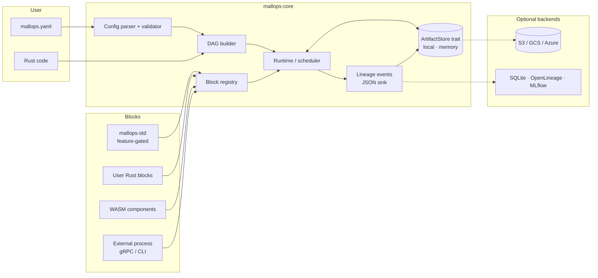
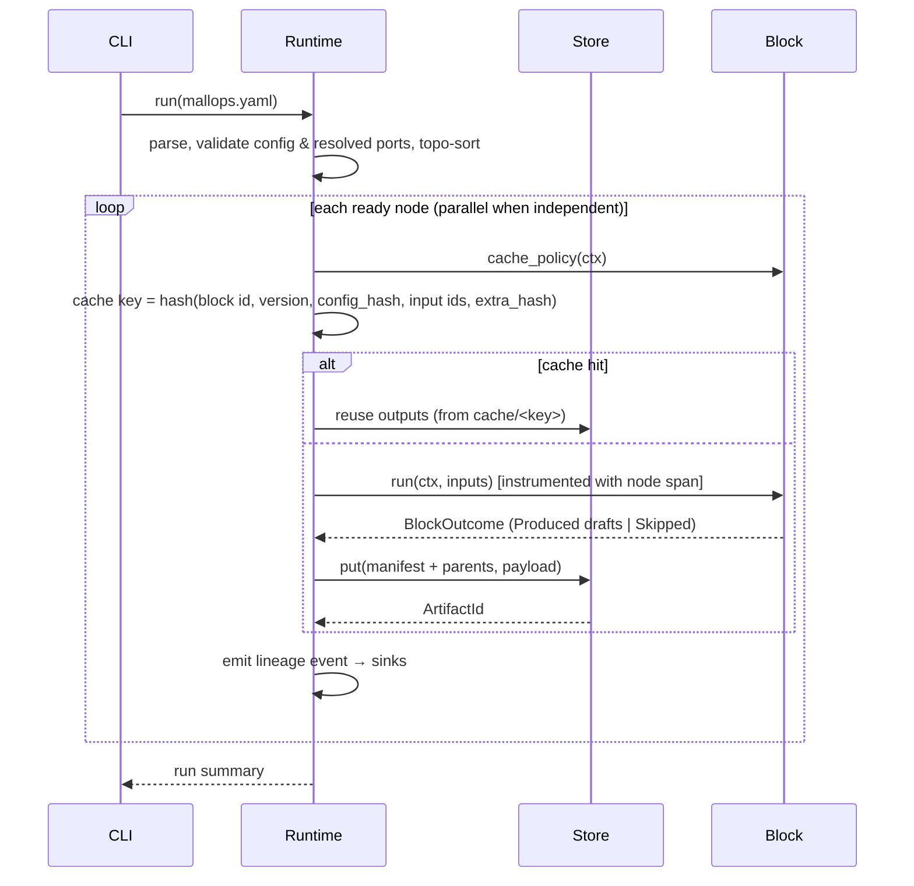
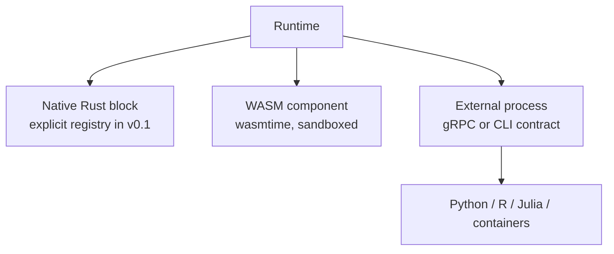
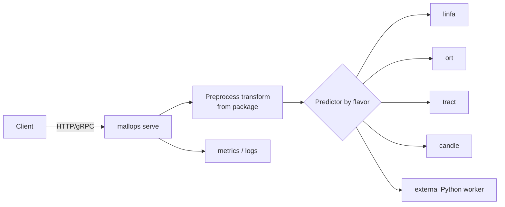
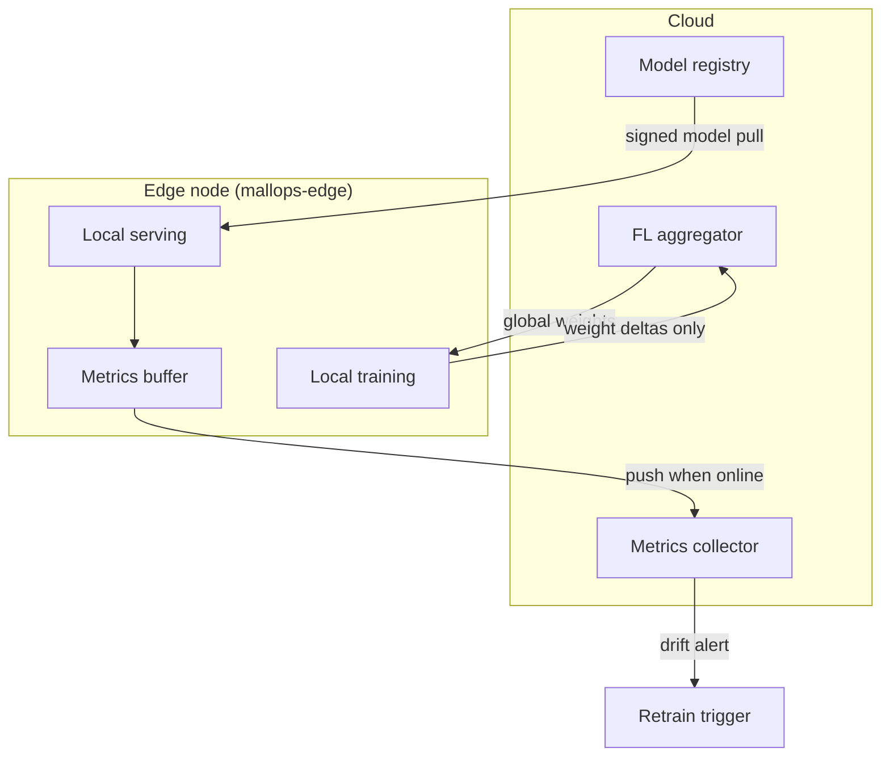

# mallops — Architecture

> Companion to [SPEC.md](SPEC.md). Decisions are recorded in [adr/](adr/README.md).

## 1. Overview



The core knows only three things: **blocks**, **artifacts**, and **the graph** between them. Everything ML-specific lives in blocks.

Store and lineage are not blocks: blocks are *nodes* of the DAG, while store and lineage act on *every edge*. The core owns their **contracts** and a minimal default; every real backend is optional ([ADR-0006](adr/0006-store-and-lineage-contracts.md)).

## 2. Workspace layout

```
mallops/
├── crates/
│   ├── mallops-core/   # traits, artifacts, store & lineage contracts, config, runtime
│   ├── mallops-cli/    # `mallops` binary              (v0.1)
│   ├── mallops-std/    # standard blocks, feature-gated (v0.1)
│   └── mallops-edge/   # edge agent + FL aggregator     (v0.4)
├── docs/
└── examples/
```

Crates are created only when implemented. Splitting `mallops-std` into per-stage crates is deferred until compile times or dependency weight demand it ([ADR-0001](adr/0001-modular-workspace.md)).

| Crate | Depends on | Dependencies |
|---|---|---|
| `mallops-core` | — | Core allowlist: `tokio`, `serde`, `serde_json`, `blake3`, `tracing`, `thiserror`, `ulid`, `tempfile`; optional features: `yaml` (`yaml_serde`, default), `schema` (`schemars`) ([ADR-0007](adr/0007-core-contracts-revision.md)) |
| `mallops-std` | core | per feature: `arrow`, `polars`, `linfa`, `ort`, `axum`, `object_store` (`store-s3`, `store-gcs`, `store-azure`), `rusqlite` (`lineage-sqlite`), … |
| `mallops-cli` | core, std | `clap`, `anyhow` |
| `mallops-edge` | core, std (subset) | `tonic` |

## 3. Core abstractions

Extensible public structs and enums are marked `#[non_exhaustive]` with dedicated constructors/builders so new fields and variants remain semver-compatible toward 1.0 ([ADR-0007](adr/0007-core-contracts-revision.md)).

```rust
/// Static description of a block: identity, version, I/O ports, optional config schema.
#[non_exhaustive]
pub struct BlockSpec {
    pub id: Cow<'static, str>,               // "std/train.external"
    pub version: Cow<'static, str>,          // "0.1.0" (included in cache key & lineage)
    pub stage: Stage,                        // Ingest, Preprocess, Train, …
    pub inputs: Vec<Port>,                   // name + kind + accepted formats/flavors (empty = any) + required
    pub outputs: Vec<Port>,
    pub config_schema: Option<serde_json::Value>, // decoupled from `schemars`
}

#[non_exhaustive]
pub enum BlockOutcome {
    Produced(OutputDrafts),                  // runtime commits drafts to ArtifactStore
    Skipped { reason: String, outputs: OutputDrafts },
}

#[non_exhaustive]
pub enum CachePolicy {
    Deterministic { extra_hash: Option<Digest> },
    Uncacheable,
}

pub trait Block: Send + Sync {
    fn spec(&self) -> &BlockSpec;
    fn validate_config(&self, config: &serde_json::Value) -> Result<(), Error> { Ok(()) }
    fn resolve_ports(&self, config: &serde_json::Value) -> Result<ResolvedPorts, Error> { /* default: spec ports */ }
    // `'a` on self and ctx: the future may use `ctx` (cancel, secrets, config, workdir).
    fn cache_policy<'a>(&'a self, ctx: &'a Context) -> BoxFuture<'a, Result<CachePolicy, Error>>;
    fn run<'a>(&'a self, ctx: &'a Context, inputs: Inputs) -> BoxFuture<'a, Result<BlockOutcome, Error>>;
}

/// `name` + `kind` + accepted `formats`/`flavors` (empty = any; several = any of them).
/// `required` defaults to `true`; `Port::optional()` clears it (read with `Inputs::try_get`).
#[non_exhaustive]
pub struct Port { pub name: Cow<'static, str>, pub kind: ArtifactKind,
    pub formats: Vec<Cow<'static, str>>, pub flavors: Vec<Cow<'static, str>>, pub required: bool }

/// Owned payload of an `OutputDraft` (`PayloadSource` borrows, so it cannot live in a draft).
/// The runtime must confine `File`/`Dir` paths inside `ctx.workdir()` before `put`.
#[non_exhaustive]
pub enum DraftPayload { File(PathBuf), Dir(PathBuf), Bytes(Vec<u8>), Files(BTreeMap<RelPath, Vec<u8>>) }

/// Given to each block during execution (runtime instruments `run()` with a tracing span).
/// Fields are private; blocks read them through accessors.
#[non_exhaustive]
pub struct Context { /* run_id, workdir, store, config, cancel, secrets */ }
impl Context {
    pub fn run_id(&self) -> RunId;
    pub fn workdir(&self) -> &Path;                          // scratch dir, also mounted for external blocks
    pub fn store(&self) -> &Arc<dyn ArtifactStore>;
    pub fn config(&self) -> &serde_json::Value;              // `with:` with `${env:…}` resolved; NEVER contains secrets
    pub fn cancel(&self) -> &CancelToken;                    // cooperative cancellation (`watch::Receiver<bool>`)
    pub fn secret(&self, name: &str) -> Result<Secret, Error>;
    pub fn config_as<T: DeserializeOwned>(&self) -> Result<T, Error>;
}
// Blocks never touch lineage and never call `store.put()` for outputs:
// the runtime commits outputs, injects `parents`, validates ports, and emits lineage events.

#[non_exhaustive]
pub struct Artifact {
    pub id: ArtifactId,                      // validated 32-byte canonical BLAKE3 digest
    pub manifest: Manifest,                  // schema_version, kind, format, flavor, io_schema, metadata, parents
}

#[non_exhaustive]
pub enum ArtifactKind { Dataset, Features, Transform, Model, Metrics, Package, Blob }

#[non_exhaustive]
pub enum Error {
    Config(String),
    Validation(Vec<ValidationError>),        // v0.1 (#3): `Validation(String)`; `Vec<ValidationError>` arriva con #6
    Store(StoreError),
    Runtime(String),
    Cancelled,
    Secret(String),
    InvalidArtifactId(String),
    InvalidPath(String),
    Block { id: String, source: Box<dyn std::error::Error + Send + Sync> },
}
```

- **Secrets (`Secret`)**: opaque newtype whose `Debug`/`Display` renders `"***"` and which does not implement `Serialize`. Resolved on demand via `ctx.secret("NAME")` (backed in v0.1 by `MALLOPS_SECRET_<NAME>` env vars) and excluded from `config.json`, cache keys, `config_hash`, logs, and lineage.
- **`Predictor` placement**: in v0.1, the minimal `Predictor` / `LoadedPredictor` contract lives in `mallops-std` (shared by `evaluate` and `serve`; see [§7 Serving](#7-serving)) and will be promoted to `mallops-core` before 1.0 once validated across backends ([ADR-0007](adr/0007-core-contracts-revision.md)).

No ML type appears in core signatures: tensors and dataframes are payload files or plugin-internal types. This is what keeps mallops library-agnostic ([ADR-0004](adr/0004-agnostic-artifacts-and-flavors.md)).

## 4. Execution model



- Scheduler: `tokio` tasks, bounded concurrency (`--jobs`), `spawn_blocking` for heavy CPU/hashing/filesystem work, cooperative `CancelToken` (+ `kill_on_drop` for external child processes).
- Failure and skipping: a failed node cancels its descendants; a `BlockOutcome::Skipped` (e.g. a failed quality gate) skips downstream nodes that require its outputs and records `Status::Skipped` in lineage. Independent branches still finish. Re-running resumes from cache.
- Batch DAG only: `serve` is not a batch DAG node. `mallops run` executes `blocks:` and produces a `package` artifact; `mallops serve` consumes that package separately ([ADR-0007](adr/0007-core-contracts-revision.md)).

## 5. Plugin model



| Kind | Use when | Isolation | Overhead |
|---|---|---|---|
| Native | Rust, performance critical | none (trusted) | zero |
| WASM | portable, untrusted, light compute | strong (sandboxed, post-v0.1) | low |
| External | other languages, GPUs, heavy frameworks | process/container (trusted, not a sandbox) | process spawn + IPC |

- **Explicit registry in v0.1**: `BlockRegistry` is an explicit, instance-local map populated via `registry.register(...)` (with `mallops_std::register_std(&mut registry)` called by `mallops-cli`). This supersedes compile-time `inventory` registration from [ADR-0003](adr/0003-plugins-wasm-and-grpc.md) for v0.1 to avoid linker stripping and global test state ([ADR-0007](adr/0007-core-contracts-revision.md)).
- **External CLI contract**: mallops materializes read-only inputs into the workdir, writes `inputs.json` (materialized paths + manifests) and `config.json` (never containing secrets; secrets pass only via explicit env allowlist), runs `command` via `argv` (never `sh -c`), and collects output files declared in `outputs.json` after validating every path with `RelPath` and rejecting symlinks. The gRPC variant adds long-lived workers and streaming. See [ADR-0003](adr/0003-plugins-wasm-and-grpc.md).

## 6. Artifact store and lineage

Two kinds of "storage" exist and must not be confused:

| | Data storage blocks | Artifact store |
|---|---|---|
| What | Persist user data to lakes, DBs, feature stores | Hand artifacts from one block to the next |
| Where in the DAG | A node | Every edge |
| In the core | No (`mallops-std` / plugins) | Contract + `local` and `memory` impls |
| Optional | Yes | The backend is; the mechanism is not |

### 6.1 Artifact store

```rust
pub trait ArtifactStore: Send + Sync {
    // Immutable content-addressed artifacts (ArtifactId = canonical BLAKE3 digest)
    fn put(&self, manifest: Manifest, payload: PayloadSource<'_>) -> BoxFuture<'_, Result<ArtifactId, Error>>;
    fn get(&self, id: &ArtifactId) -> BoxFuture<'_, Result<Option<Artifact>, Error>>;
    /// Materialize the payload into `dest` (isolated writable copy locally; download + verify remotely).
    /// Never returns a writable path inside the store itself.
    fn fetch(&self, id: &ArtifactId, dest: &Path) -> BoxFuture<'_, Result<PathBuf, Error>>;
    fn verify(&self, id: &ArtifactId) -> BoxFuture<'_, Result<(), Error>>;
    fn exists(&self, id: &ArtifactId) -> BoxFuture<'_, Result<bool, Error>>;

    // Auxiliary metadata keyed by validated RelPath (cache index, lineage.json, v0.2 registry)
    fn put_meta(&self, key: &RelPath, data: &[u8]) -> BoxFuture<'_, Result<(), Error>>;
    fn get_meta(&self, key: &RelPath) -> BoxFuture<'_, Result<Option<Vec<u8>>, Error>>;
    fn list_meta(&self, prefix: &RelPath) -> BoxFuture<'_, Result<Vec<RelPath>, Error>>;
    fn delete_meta(&self, key: &RelPath) -> BoxFuture<'_, Result<(), Error>>;
}
```

- Validated types: `ArtifactId` (strict 64 lowercase hex) and `RelPath` (normalized POSIX UTF-8 relative path, no `..`, no root prefixes) prevent path traversal across all store operations.
- Immutability: `put` writes atomically (temp dir + idempotent rename), rejects symlinks and special files, and marks stored payloads read-only on `LocalStore` (`0444` files / `0555` dirs where supported). `fetch` always materializes an isolated writable copy into `dest` so no block can mutate stored artifacts in place.
- Core implementations: `LocalStore` (filesystem, default, `./.mallops`) and `MemoryStore` (ephemeral; tests and throwaway runs).
- Optional: `ObjectStore` adapter over the `object_store` crate (S3, GCS, Azure) behind `mallops-std` features; anything else as a plugin.
- What depends on it: data hand-off between nodes and processes, caching (`cache/<key>.json`), resume via cached re-runs, `JsonSink` (`runs/<run-id>/lineage.json`), and model registry (v0.2).
- Layout (`LocalStore`): `artifacts/<hash>/…`, `meta/cache/<key>.json`, `meta/runs/<run-id>/lineage.json`, `meta/registry/<model>/<version>.json` (v0.2), `.tmp/` (staging).

### 6.2 Lineage

```rust
#[non_exhaustive]
pub enum LineageEvent {
    RunStarted {
        run: RunId,
        timestamp: Timestamp,
        pipeline_hash: Digest,
        git_commit: Option<String>,
        host: HostInfo,
    },
    BlockStarted {
        run: RunId,
        timestamp: Timestamp,
        node: String,
        block: BlockRef,
        block_version: String,
        config_hash: Digest,
        seed: Option<u64>,
        inputs: Vec<ArtifactId>,
    },
    ArtifactProduced { run: RunId, timestamp: Timestamp, node: String, artifact: ArtifactId },
    BlockFinished {
        run: RunId,
        timestamp: Timestamp,
        node: String,
        status: Status, // Succeeded | Failed | Skipped | Cancelled
        duration: Duration,
        cached: bool,
    },
    RunFinished { run: RunId, timestamp: Timestamp, status: Status },
}

pub trait LineageSink: Send + Sync {
    fn record(&self, event: &LineageEvent) -> BoxFuture<'_, Result<(), Error>>;
}
```

- The runtime is the only producer: it alone sees the whole graph. Blocks stay unaware of lineage.
- Core sink: `JsonSink`, writing `runs/<run-id>/lineage.json` through `ArtifactStore::put_meta`.
- Optional sinks: SQLite (queryable), OpenLineage (Marquez, DataHub…), MLflow — `mallops-std` features or plugins.
- Zero or more sinks; `lineage: off` disables it. A failing sink logs a warning and never fails the run.
- Caching does **not** depend on lineage: it uses artifact hashes and `cache/<key>.json` in the store.

## 7. Serving

Serving runs outside the batch DAG via `mallops serve [package-id]` (using the package artifact produced by `mallops run` or configured in the top-level `serve:` section of `mallops.yaml`).



In v0.1, the minimal `Predictor` contract lives in `mallops-std` (shared by `evaluate` and `serve`) before promotion to `mallops-core` ahead of 1.0 ([ADR-0007](adr/0007-core-contracts-revision.md)):

```rust
pub enum PredictInput {
    Json(serde_json::Value),
    Bytes { content_type: String, data: Vec<u8> },
}

pub trait Predictor: Send + Sync {
    fn flavors(&self) -> &[&str];                       // e.g. ["linfa-logistic"], ["sklearn-pickle"]
    fn executes_code(&self) -> bool;                    // true for pickle/joblib/torchscript
    fn load(&self, pkg: &Artifact, workdir: &Path) -> BoxFuture<'_, Result<Box<dyn LoadedPredictor>, Error>>;
}

pub trait LoadedPredictor: Send + Sync {
    fn predict(&self, input: PredictInput) -> BoxFuture<'_, Result<PredictInput, Error>>;
    fn predict_batch(&self, inputs: Vec<PredictInput>) -> BoxFuture<'_, Result<Vec<PredictInput>, Error>>;
}
```

Flavors where `executes_code()` is `true` are rejected by `mallops serve` unless `--trust-unsafe-flavors` is explicitly enabled.

## 8. Edge and federated learning (v0.4)



- Transport: gRPC (`tonic`) with mTLS; nodes initiate connections (NAT-friendly).
- Aggregation strategies are blocks (FedAvg default); privacy techniques plug in at the aggregator.
- Model weights exchanged in whatever format the flavor defines; the aggregator delegates averaging to a flavor-aware plugin.

## 9. Cross-cutting concerns

| Concern | Choice |
|---|---|
| Errors | `thiserror` in libraries (`mallops_core::Error`), `anyhow` only in the CLI |
| Logging/tracing | `tracing`; OpenTelemetry exporter behind a feature |
| Config | `serde` + `serde_json` + `yaml_serde` (`yaml` feature) + optional `schemars` (`schema` feature) |
| Async | `tokio` |
| CLI | `clap` derive |
| Testing | unit tests per crate, integration tests running example pipelines, `insta` snapshots for CLI output |
