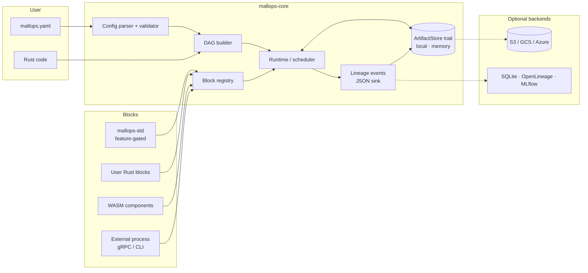
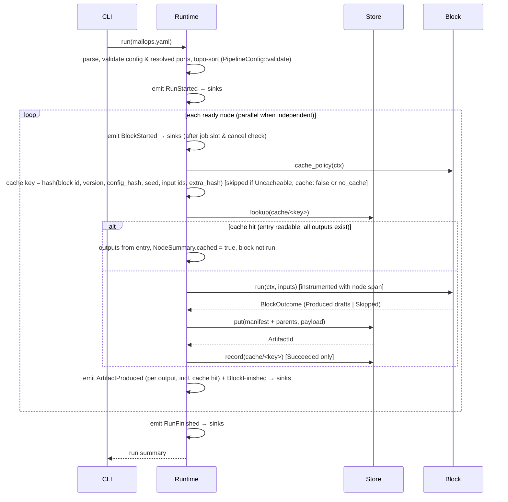
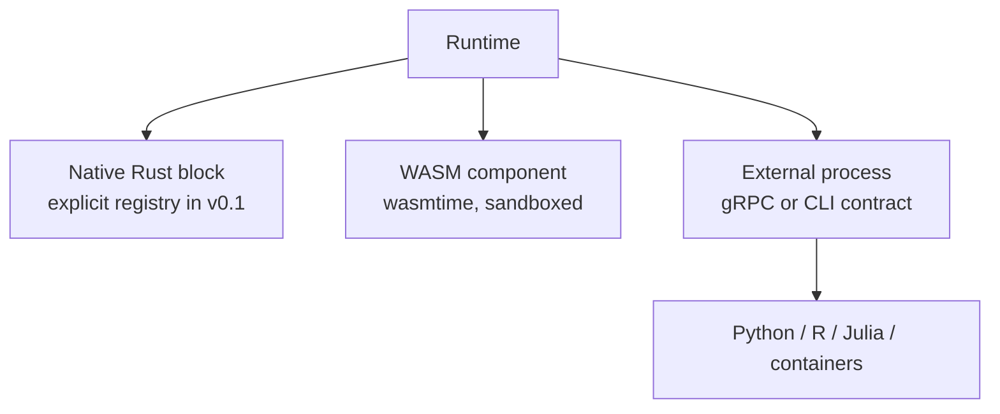
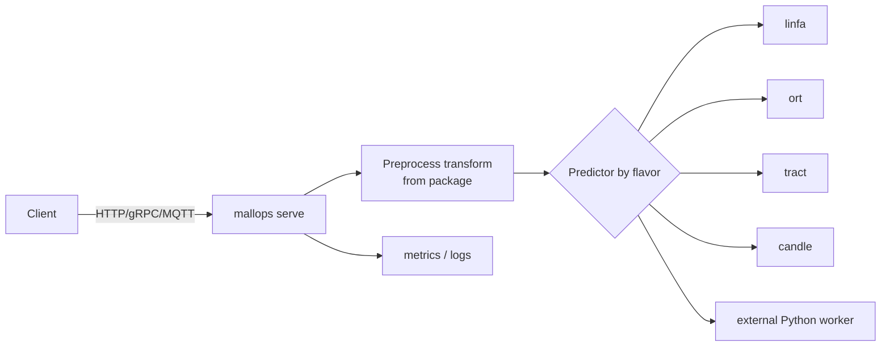
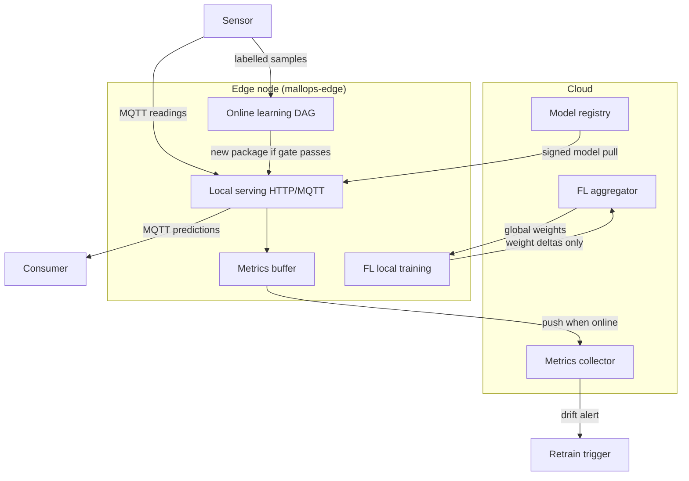

# mallops — Architecture

> Companion to [SPEC.md](SPEC.md). Decisions are recorded in [adr/](adr/README.md).

## 1. Overview



The core knows only three things: **blocks**, **artifacts**, and **the graph** between them. Everything ML-specific lives in blocks.

Store and lineage are not blocks: blocks are *nodes* of the DAG, while store and lineage act on *every edge*. The core owns their **contracts** and a minimal default; every real backend is optional ([ADR-0006](adr/0006-store-and-lineage-contracts.md)).

## 2. Workspace layout

```
mallops/
├── crates/
│   ├── mallops-core/   # traits, artifacts, store & lineage contracts, config, runtime
│   ├── mallops-cli/    # `mallops` binary              (v0.1)
│   ├── mallops-std/    # standard blocks, feature-gated (v0.1)
│   └── mallops-edge/   # edge agent + FL aggregator     (v0.4)
├── docs/
└── examples/
```

Crates are created only when implemented. Splitting `mallops-std` into per-stage crates is deferred until compile times or dependency weight demand it ([ADR-0001](adr/0001-modular-workspace.md)).

| Crate | Depends on | Dependencies |
|---|---|---|
| `mallops-core` | — | Core allowlist: `tokio`, `serde`, `serde_json`, `blake3`, `tracing`, `thiserror`, `ulid`, `tempfile`; optional features: `yaml` (`yaml_serde`, default), `schema` (`schemars`) ([ADR-0007](adr/0007-core-contracts-revision.md)) |
| `mallops-std` | core | workspace `blake3`, `serde`, `serde_json`, `tokio` (already in the graph via core); optional behind per-block Cargo features (`--no-default-features` pulls in no Arrow or Parquet crate): `ingest-csv` (`arrow-csv` `59`), `ingest-parquet`, meta-feature `ingest = ["ingest-csv", "ingest-parquet"]` (default), `preprocess-tabular` (default; `arrow-cast` `59`, `arrow-ord` `59`, `arrow-select` `59`, internal SplitMix64+Fisher-Yates PRNG with no `rand`), all sharing internal `_ingest` (`arrow-array` `59`, `arrow-schema` `59`, `parquet` `59` with `default-features = false, features = ["arrow", "snap", "lz4", "flate2-zlib-rs", "zstd"]` — pinned to `59` because `60` requires Rust 1.88 > MSRV 1.85; codecs are for reading external Parquet files while outputs stay uncompressed); future features: `linfa`, `ort`, `axum`, `object_store` (`store-s3`, `store-gcs`, `store-azure`), `rusqlite` (`lineage-sqlite`), … |
| `mallops-cli` | core, std | `clap` (`derive`), `anyhow`, `serde_json`, `tracing-subscriber` (`fmt`), `tokio` (`rt-multi-thread`); dev: `insta`, `tempfile` |
| `mallops-edge` | core, std (`profile-edge`, ADR-0008) | `tonic`, `rumqttc` (via `serve-mqtt`) |

`mallops-std` exposes `pub fn register_std(registry: &mut BlockRegistry) -> Result<(), Error>`, registering only the blocks whose Cargo features are enabled and returning `Error::Validation` if a block id is already registered. `std/ingest.csv` and `std/ingest.parquet` share the internal `ingest` module: expected `schema` columns (`bool | int64 | float64 | string | date32`), uncompressed `data.parquet` output with fixed `created_by: "mallops-std"` (`kind: dataset`, `format: parquet`; deterministic per `mallops-std` version, source schema/field metadata stripped), streamed BLAKE3 `extra_hash` in `CachePolicy::Deterministic`, and `tokio::task::spawn_blocking` with between-batch `CancelToken` checks for file I/O and conversion (relative paths resolve against the process cwd, which `mallops run` sets to the directory of `mallops.yaml`). Known v0.1 limitations are documented in [SPEC §3.1](SPEC.md#31-data-ingestion) (TOCTOU between `cache_policy` and `run`, and inferred CSV types `Null`/`Timestamp` outside the `schema:` subset).

Behind the `preprocess-tabular` feature, `mallops-std` provides the `preprocess` module implementing `std/preprocess.tabular`: `mod.rs` (config validation, dynamic `validation` output port via `resolve_ports`, and `spawn_blocking` orchestration; v0.1 loads the full input Parquet dataset into memory), `split.rs` (seeded SplitMix64 + Fisher-Yates row partitioning with `floor(n * ratio)` counts in `f64`), `steps.rs` (trait-free Arrow kernels for `filter`, `fit`, and `FittedStep::apply`), and `transform.rs`. `mallops-std` re-exports `FittedTransform` and `TRANSFORM_FILE` (`"transform.json"`) so `package` (#16) and `serve` (#17) can reload the canonical artifact `{"v":1,"target":…,"input":[…],"steps":[…]}` with `FittedTransform::from_dir` and replay the exact training preprocessing on Arrow batches (`apply_batch`, projecting onto `input` with type checks) or JSON inference rows (`apply_json`, target optional, missing non-target keys rejected, explicit `null` allowed, unknown keys ignored).

## 3. Core abstractions

Extensible public structs and enums are marked `#[non_exhaustive]` with dedicated constructors/builders so new fields and variants remain semver-compatible toward 1.0 ([ADR-0007](adr/0007-core-contracts-revision.md)).

```rust
/// Static description of a block: identity, version, I/O ports, optional config schema.
#[non_exhaustive]
pub struct BlockSpec {
    pub id: Cow<'static, str>,               // "std/train.external"
    pub version: Cow<'static, str>,          // "0.1.0" (included in cache key & lineage)
    pub stage: Stage,                        // Ingest, Preprocess, Train, …
    pub inputs: Vec<Port>,                   // name + kind + accepted formats/flavors (empty = any) + required
    pub outputs: Vec<Port>,
    pub config_schema: Option<serde_json::Value>, // decoupled from `schemars`
}

#[non_exhaustive]
pub enum BlockOutcome {
    Produced(OutputDrafts),                  // runtime commits drafts to ArtifactStore
    Skipped { reason: String, outputs: OutputDrafts },
}

#[non_exhaustive]
pub enum CachePolicy {
    Deterministic { extra_hash: Option<Digest> },
    Uncacheable,
}

pub trait Block: Send + Sync {
    fn spec(&self) -> &BlockSpec;
    fn validate_config(&self, config: &serde_json::Value) -> Result<(), Error> { Ok(()) }
    fn resolve_ports(&self, config: &serde_json::Value) -> Result<ResolvedPorts, Error> { /* default: spec ports */ }
    // `'a` on self and ctx: the future may use `ctx` (cancel, secrets, config, workdir).
    fn cache_policy<'a>(&'a self, ctx: &'a Context) -> BoxFuture<'a, Result<CachePolicy, Error>>;
    fn run<'a>(&'a self, ctx: &'a Context, inputs: Inputs) -> BoxFuture<'a, Result<BlockOutcome, Error>>;
}

/// `name` + `kind` + accepted `formats`/`flavors` (empty = any; several = any of them).
/// `required` defaults to `true`; `Port::optional()` clears it (read with `Inputs::try_get`).
#[non_exhaustive]
pub struct Port { pub name: Cow<'static, str>, pub kind: ArtifactKind,
    pub formats: Vec<Cow<'static, str>>, pub flavors: Vec<Cow<'static, str>>, pub required: bool }

/// Owned payload of an `OutputDraft` (`PayloadSource` borrows, so it cannot live in a draft).
/// The runtime must confine `File`/`Dir` paths inside `ctx.workdir()` before `put`.
#[non_exhaustive]
pub enum DraftPayload { File(PathBuf), Dir(PathBuf), Bytes(Vec<u8>), Files(BTreeMap<RelPath, Vec<u8>>) }

/// Given to each block during execution (runtime instruments `run()` with a tracing span).
/// Fields are private; blocks read them through accessors.
#[non_exhaustive]
pub struct Context { /* run_id, workdir, store, config, cancel, secrets */ }
impl Context {
    pub fn run_id(&self) -> RunId;
    pub fn workdir(&self) -> &Path;                          // scratch dir, also mounted for external blocks
    pub fn store(&self) -> &Arc<dyn ArtifactStore>;
    pub fn config(&self) -> &serde_json::Value;              // `with:` with `${env:…}` resolved; NEVER contains secrets
    pub fn cancel(&self) -> &CancelToken;                    // cooperative cancellation (`watch::Receiver<bool>`)
    pub fn secret(&self, name: &str) -> Result<Secret, Error>;
    pub fn config_as<T: DeserializeOwned>(&self) -> Result<T, Error>;
}
// Blocks never touch lineage and never call `store.put()` for outputs:
// the runtime commits outputs, injects `parents`, validates ports, and emits lineage events.

#[non_exhaustive]
pub struct Artifact {
    pub id: ArtifactId,                      // validated 32-byte canonical BLAKE3 digest
    pub manifest: Manifest,                  // schema_version, kind, format, flavor, io_schema, metadata, parents
}

#[non_exhaustive]
pub enum ArtifactKind { Dataset, Features, Transform, Model, Metrics, Package, Blob }

#[non_exhaustive]
pub enum Error {
    Config(String),
    Validation(Vec<ValidationError>),        // all problems of one pass; ValidationError { path, message }
    Store(StoreError),
    Runtime(String),
    Cancelled,
    Secret(String),
    InvalidArtifactId(String),
    InvalidPath(String),
    Block { id: String, source: Box<dyn std::error::Error + Send + Sync> },
}

/// Runtime settings: `new(store)` defaults to available parallelism, `EnvSecretProvider`,
/// `std::env::temp_dir()`, a cancel token that never fires, one `JsonSink` on `store`,
/// `SystemTime::now`, `HostInfo::current()`, and `git_commit: None`.
#[non_exhaustive]
pub struct RuntimeConfig {
    pub max_jobs: usize,                     // `--jobs`; 0 counts as 1
    pub store: Arc<dyn ArtifactStore>,
    pub secret_provider: Arc<dyn SecretProvider>,
    pub workdir_root: PathBuf,               // per-run temporary workdirs are created here
    pub cancel: CancelToken,                 // external cancellation, seen by blocks via ctx.cancel()
    pub no_cache: bool,                      // `--no-cache`: every node runs, no cache entry read or written
    pub lineage: Vec<Arc<dyn LineageSink>>,  // empty = `lineage: off`; YAML mapping lives in `mallops-cli`
    pub clock: fn() -> SystemTime,           // injectable for deterministic tests
    pub host: HostInfo,                      // recorded in `RunStarted`
    pub git_commit: Option<String>,          // `None` in core; set by `mallops run` via `git rev-parse HEAD`
}

pub struct Runtime { /* config */ }
impl Runtime {
    pub fn new(config: RuntimeConfig) -> Self;
    // Err only for runtime failures; node outcomes are in the summary.
    pub async fn run(&self, pipeline: &ValidatedPipeline) -> Result<RunSummary, Error>;
}

#[non_exhaustive]
pub struct RunSummary { pub run_id: RunId, pub nodes: BTreeMap<String, NodeSummary> } // is_success()

#[non_exhaustive]
pub struct NodeSummary {
    pub status: Status,
    pub duration: Duration,                  // zero if the node never started or its task panicked
    pub outputs: BTreeMap<String, ArtifactId>, // committed outputs by port
    pub reason: Option<String>,              // why skipped / cancelled
    pub error: Option<Error>,                // Failed node, or Error::Cancelled from a cancelled block
    pub cached: bool,                        // outputs served from the cache, block not run
}

#[non_exhaustive]
pub enum Status { Succeeded, Failed, Skipped, Cancelled }
```

- **Validation**: `PipelineConfig::validate(&BlockRegistry) -> Result<ValidatedPipeline, Error>` checks DAG, resolved ports, `with:` configs and `serve.package` in one pass without running any block, aggregating `ValidationError { path, message }` (dotted paths such as `blocks.eval.in.test`, see SPEC §5). `ValidatedPipeline` holds nodes in topological order (ties by id), each with its `Arc<dyn Block>`, `BlockConfig` and `ResolvedPorts`. `PipelineBuilder` builds the same `PipelineConfig` in Rust, available without the `yaml` feature, and `build(&registry)` goes through the same validator.
- **Secrets (`Secret`)**: opaque newtype whose `Debug`/`Display` renders `"***"` and which does not implement `Serialize`. Resolved on demand via `ctx.secret("NAME")` (backed in v0.1 by `MALLOPS_SECRET_<NAME>` env vars) and excluded from `config.json`, cache keys, `config_hash`, logs, and lineage.
- **`Predictor` placement**: in v0.1, the minimal `Predictor` / `LoadedPredictor` contract lives in `mallops-std` (shared by `evaluate` and `serve`; see [§7 Serving](#7-serving)) and will be promoted to `mallops-core` before 1.0 once validated across backends ([ADR-0007](adr/0007-core-contracts-revision.md)).

No ML type appears in core signatures: tensors and dataframes are payload files or plugin-internal types. This is what keeps mallops library-agnostic ([ADR-0004](adr/0004-agnostic-artifacts-and-flavors.md)).

## 4. Execution model



- Scheduler: nodes in topological order start as soon as all their upstream nodes have finished, as `tokio` tasks in a `JoinSet`, bounded by a `Semaphore` of `max_jobs` permits (`--jobs`); `spawn_blocking` for heavy CPU/hashing/filesystem work (+ `kill_on_drop` for external child processes). Each node runs through one function (`run_node`: job slot → cancel check → `BlockStarted` → instrumented `execute` (`Context` → `cache_policy` → cache lookup → on a miss load inputs with `store.get` → `block.run` → commit → cache record) → `ArtifactProduced` per output (including cache hits) → `BlockFinished`), the single place where caching (#8) and lineage (#9) hook in. Once the node holds a job slot and the run is not cancelled, `execute` is wrapped with `.instrument(info_span!("node", id, block))`; the span never lives in `Context`. Nodes that never start (stopped by `gate` as `Skipped` or `Cancelled`, or cancelled before starting) emit only `BlockFinished` with `duration: Duration::ZERO`. A block that panics makes its node `Failed` (`Error::Runtime`, duration 0) and emits `BlockFinished` instead of crashing the run. `RunStarted` is emitted before scheduling any node, and `RunFinished` after all nodes settle and the workdir is cleaned up.
- Cache (`runtime/cache.rs`): The cache is bypassed (no lookup, no record) when the node has `cache: false` or `RuntimeConfig::no_cache` is set; `cache_policy` is then not called. Otherwise `cache_policy` is asked (an error fails the node) and an `Uncacheable` policy bypasses it too. `extra_hash` must not depend on secret values (NFR-4). A hit makes the node `Succeeded` with `NodeSummary::cached = true` and outputs from the entry; the block does not run and inputs are not loaded (the node span still exists). On a miss the node runs as usual and, only if `Succeeded`, `record` stores the entry; `Skipped`, `Failed` and `Cancelled` are never cached. A `record` error, or a store error during `lookup`, is a `tracing::warn!` (the lookup error counts as a miss and the entry is rewritten), never a node failure. An unreadable or other-version entry, or one referencing an artifact missing from the store (`exists`), is a miss and gets overwritten.
- Failure: a node whose block or commit fails is `Status::Failed` (with its `error`); all its descendants are `Cancelled` without running, with a reason naming the failed node. Independent branches still finish. Re-running resumes from cache.
- Skipping: `BlockOutcome::Skipped` (e.g. a failed quality gate) marks the node `Skipped`; outputs it still returns are committed. A consumer with any **required** input from a `Skipped` node, or whose required upstream output was not committed, is `Skipped` without running, even when its other inputs succeeded (fan-in). Optional inputs without a committed artifact are absent from `Inputs`. A failed or cancelled parent wins over a skipped one (`Cancelled`).
- Cancellation: cooperative through `RuntimeConfig::cancel`, the token blocks see as `ctx.cancel()`. Once it fires no new node starts (`Cancelled`, reason `run cancelled`); a block that returns `Error::Cancelled` is `Cancelled` with that error, not `Failed`. In-flight tasks are never aborted.
- Commit (`runtime/commit.rs`): drafts are checked before any `store.put`, and all violations are reported at once as `Error::Validation` with paths `out.<port>`: unknown output port, `Port::accepts_manifest` mismatch (kind/format/flavor), missing required output on `Produced` (optional on `Skipped`), `File`/`Dir` payloads that do not canonicalize inside the node workdir (no `..` or symlink escapes) or are not a regular file / a directory. `put` receives the canonical path; the window between check and `put` is accepted by the trust model (ADR-0007 D7). `manifest.parents` is replaced by the node's input ids, sorted and deduplicated. Payload content (nested symlinks, special files in a `Dir`) is rejected by the store during `put` (`ArtifactStore` contract); outputs of the same node committed before stay as unreferenced, immutable artifacts until a later GC.
- Workdir: each run creates a `tempfile::TempDir` (prefix `mallops-run-<run_id>-`) in `workdir_root` and canonicalizes it, so `ctx.workdir()` (one subdirectory per node, named by its index) is absolute and canonical even for a relative or symlinked root; it is removed with `spawn_blocking` when the run ends.
- Result: `run` returns `Err` only for runtime-level failures (e.g. the run workdir cannot be created); node outcomes go to the `RunSummary`.
- Batch DAG only: `serve` is not a batch DAG node. `mallops run` executes `blocks:` and produces a `package` artifact; `mallops serve` consumes that package separately ([ADR-0007](adr/0007-core-contracts-revision.md)).

## 5. Plugin model



| Kind | Use when | Isolation | Overhead |
|---|---|---|---|
| Native | Rust, performance critical | none (trusted) | zero |
| WASM | portable, untrusted, light compute | strong (sandboxed, post-v0.1) | low |
| External | other languages, GPUs, heavy frameworks | process/container (trusted, not a sandbox) | process spawn + IPC |

- **Explicit registry in v0.1**: `BlockRegistry` is an explicit, instance-local map populated via `registry.register(...)`. `mallops-cli` registers the built-in `core/noop` block and calls `mallops_std::register_std(&mut registry)` (returning `Result<(), Error>` so duplicate block ids fail with `Error::Validation`). This supersedes compile-time `inventory` registration from [ADR-0003](adr/0003-plugins-wasm-and-grpc.md) for v0.1 to avoid linker stripping and global test state ([ADR-0007](adr/0007-core-contracts-revision.md)). Blocks are keyed by their `spec().id`, parsed as a `BlockRef` (grammar in SPEC §5); registering an id twice returns `Error::Validation` and keeps the original, and `list()` returns specs sorted by id.
- **External CLI contract**: mallops materializes read-only inputs into the workdir, writes `inputs.json` (materialized paths + manifests) and `config.json` (never containing secrets; secrets pass only via explicit env allowlist), runs `command` via `argv` (never `sh -c`), and collects output files declared in `outputs.json` after validating every path with `RelPath` and rejecting symlinks. The gRPC variant adds long-lived workers and streaming. See [ADR-0003](adr/0003-plugins-wasm-and-grpc.md).

## 6. Artifact store and lineage

Two kinds of "storage" exist and must not be confused:

| | Data storage blocks | Artifact store |
|---|---|---|
| What | Persist user data to lakes, DBs, feature stores | Hand artifacts from one block to the next |
| Where in the DAG | A node | Every edge |
| In the core | No (`mallops-std` / plugins) | Contract + `local` and `memory` impls |
| Optional | Yes | The backend is; the mechanism is not |

### 6.1 Artifact store

```rust
pub trait ArtifactStore: Send + Sync {
    // Immutable content-addressed artifacts (ArtifactId = canonical BLAKE3 digest)
    fn put(&self, manifest: Manifest, payload: PayloadSource<'_>) -> BoxFuture<'_, Result<ArtifactId, Error>>;
    fn get(&self, id: &ArtifactId) -> BoxFuture<'_, Result<Option<Artifact>, Error>>;
    /// Materialize the payload into `dest` (isolated writable copy locally; download + verify remotely).
    /// Never returns a writable path inside the store itself.
    fn fetch(&self, id: &ArtifactId, dest: &Path) -> BoxFuture<'_, Result<PathBuf, Error>>;
    fn verify(&self, id: &ArtifactId) -> BoxFuture<'_, Result<(), Error>>;
    fn exists(&self, id: &ArtifactId) -> BoxFuture<'_, Result<bool, Error>>;

    // Auxiliary metadata keyed by validated RelPath (cache index, lineage.json, runs/latest.json, v0.2 registry)
    fn put_meta(&self, key: &RelPath, data: &[u8]) -> BoxFuture<'_, Result<(), Error>>;
    fn get_meta(&self, key: &RelPath) -> BoxFuture<'_, Result<Option<Vec<u8>>, Error>>;
    fn list_meta(&self, prefix: &RelPath) -> BoxFuture<'_, Result<Vec<RelPath>, Error>>;
    fn delete_meta(&self, key: &RelPath) -> BoxFuture<'_, Result<(), Error>>;
}
```

- Validated types: `ArtifactId` (strict 64 lowercase hex) and `RelPath` (normalized POSIX UTF-8 relative path, no `..`, no root prefixes) prevent path traversal across all store operations.
- Immutability: `put` writes atomically (temp dir + idempotent rename), rejects symlinks and special files, and marks stored payloads read-only on `LocalStore` (`0444` files / `0555` dirs where supported). `fetch` always materializes an isolated writable copy into `dest` so no block can mutate stored artifacts in place.
- Core implementations: `LocalStore` (filesystem, default, `./.mallops`, resolved by the CLI relative to the directory of `mallops.yaml`) and `MemoryStore` (ephemeral; tests and throwaway runs).
- Optional: `ObjectStore` adapter over the `object_store` crate (S3, GCS, Azure) behind `mallops-std` features; anything else as a plugin.
- What depends on it: data hand-off between nodes and processes, caching (`cache/<key>.json`), resume via cached re-runs, `JsonSink` (`runs/<run-id>/lineage.json`), latest run pointer (`runs/latest.json`), and model registry (v0.2).
- Layout (`LocalStore`): `artifacts/<hash>/…`, `meta/cache/<key>.json`, `meta/runs/<run-id>/lineage.json`, `meta/runs/latest.json`, `meta/registry/<model>/<version>.json` (v0.2), `.tmp/` (staging).
- Latest run pointer (`runs/latest.json`): written by `mallops run` via `put_meta` only when every node is `Succeeded`, as `{"v":1,"pipeline":"<name>","run":"<run-id>","outputs":{"<node>":{"<port>":"<artifact-id>"}}}` (deterministic `BTreeMap` key ordering). Runs with `Skipped` nodes leave any previous `runs/latest.json` untouched, print `latest.json not updated: <S> skipped`, and exit `0`; failed runs leave it untouched and exit `1`.
- Cache key (`cache_key`, domain-separated BLAKE3): block id, `BlockSpec.version`, `config_hash` (canonical JSON of `with:`, secrets stay as literal `${secret:NAME}` so rotating a value does not invalidate), `seed`, the sorted `(port, input artifact id)` pairs, and `extra_hash` of `CachePolicy::Deterministic`. Node id and `use:` are not part of it. Entry: `cache/<key-hex>.json` = `{"v":1,"outputs":{"<port>":"<artifact-id>"}}`, stored through `put_meta`.

### 6.2 Lineage

```rust
/// Wall-clock instant; serializes as RFC 3339 UTC with millisecond precision.
pub struct Timestamp(SystemTime);

#[non_exhaustive]
pub struct HostInfo {
    pub os: String,              // std::env::consts::OS
    pub arch: String,            // std::env::consts::ARCH
    pub hostname: String,        // HOSTNAME / COMPUTERNAME env var, or "unknown"
    pub mallops_version: String, // CARGO_PKG_VERSION
}

#[non_exhaustive]
#[serde(tag = "event", rename_all = "snake_case")]
pub enum LineageEvent {
    #[non_exhaustive]
    RunStarted {
        run: RunId,
        timestamp: Timestamp,
        pipeline_hash: Digest,
        git_commit: Option<String>,
        host: HostInfo,
    },
    #[non_exhaustive]
    BlockStarted {
        run: RunId,
        timestamp: Timestamp,
        node: String,
        block: BlockRef,         // serialized via Display as a string (e.g. "std/train.external")
        block_version: String,
        config_hash: Digest,
        seed: Option<u64>,
        inputs: Vec<ArtifactId>,
    },
    #[non_exhaustive]
    ArtifactProduced { run: RunId, timestamp: Timestamp, node: String, artifact: ArtifactId },
    #[non_exhaustive]
    BlockFinished {
        run: RunId,
        timestamp: Timestamp,
        node: String,
        status: Status,          // snake_case: succeeded | failed | skipped | cancelled
        duration: Duration,      // serialized as `duration_ms: u64`
        cached: bool,
    },
    #[non_exhaustive]
    RunFinished { run: RunId, timestamp: Timestamp, status: Status },
}

pub trait LineageSink: Send + Sync {
    fn record<'a>(&'a self, event: &'a LineageEvent) -> BoxFuture<'a, Result<(), Error>>;
}
```

- The runtime is the only producer: it alone sees the whole graph. Blocks stay unaware of lineage.
- Document format (`JsonSink`): writes `runs/<run-id>/lineage.json` through `ArtifactStore::put_meta` (on `LocalStore`: `meta/runs/<run-id>/lineage.json`) as `{"v":1,"run":"<run-id>","events":[...]}`. Events use an internally tagged `snake_case` `"event"` field (`run_started`, `block_started`, `artifact_produced`, `block_finished`, `run_finished`); `timestamp` is RFC 3339 UTC with millisecond precision (`YYYY-MM-DDTHH:MM:SS.mmmZ`, computed from `UNIX_EPOCH` without an external date crate); `BlockStarted.block` serializes as a string; `BlockFinished.duration` serializes as `duration_ms` (`u64`); `Status` serializes in `snake_case`. `JsonSink` buffers events per run and rewrites the file on every event so it remains valid JSON after a crash, freeing the run's buffer on `RunFinished`.
- Configuration (`RuntimeConfig`): `lineage` defaults to `[JsonSink::new(store)]` (empty `Vec` disables lineage, corresponding to `lineage: off`; `mallops-cli` maps `off` → `vec![]` and `sink: json` → `JsonSink::new(store)`, rejecting unknown sinks in `validate`, `run`, and `store verify`), `clock` defaults to `SystemTime::now` (injectable for deterministic tests), `host` defaults to `HostInfo::current()` (reads `HOSTNAME`, falling back to `COMPUTERNAME` or `"unknown"` — env-only, no unsafe/libc), and `git_commit` defaults to `None` in the core library (`mallops run` populates it via best-effort `git rev-parse HEAD` in the directory of `mallops.yaml` with stderr suppressed; never spawned by `validate`, `graph`, or `store verify`).
- `pipeline_hash`: `blake3::derive_key("mallops pipeline v1", ...)` over the canonical JSON array of validated nodes in topological order (`id`, `use`, `BlockSpec.version`, `config_hash`, `in`, `seed`).
- Event order and statuses:
  - Started node: `BlockStarted` → one `ArtifactProduced` per output in `NodeSummary.outputs` → `BlockFinished`. Cache hits still emit `BlockStarted`, `ArtifactProduced` for every cached output, and `BlockFinished` with `cached: true`.
  - Node that never starts (stopped by `gate`, cancelled before starting, or unscheduled): only `BlockFinished` with `duration_ms: 0` and `cached: false`.
  - Panicking node task: `BlockStarted` (already emitted) followed by `BlockFinished` (`status: "failed"`, `duration_ms: 0`, `cached: false`).
  - `RunFinished.status`: `Cancelled` if `RuntimeConfig::cancel` fired, else `Succeeded` if `RunSummary::is_success()`, else `Failed`.
- Dispatch and fault isolation: every event is sent to each sink in `RuntimeConfig::lineage` in order; if a sink returns `Err`, the runtime logs `tracing::warn!` and continues to the remaining sinks — a failing sink never fails the run.
- Conformance suite: `mallops_core::lineage::conformance::check_sink` verifies a full event sequence covering all four `Status` variants and interleaved concurrent runs (supporting both read-back and write-only sinks), reusable by future sink backends (SQLite, OpenLineage, MLflow — `mallops-std` features or plugins in v0.2+).
- Caching does **not** depend on lineage: it uses artifact hashes and `cache/<key>.json` in the store.

## 7. Serving

Serving runs outside the batch DAG via `mallops serve [package-id]` (using the package artifact produced by `mallops run` or configured in the top-level `serve:` section of `mallops.yaml`). Transports: HTTP (v0.1), gRPC (v0.2) and MQTT (v0.3, `serve.transport: mqtt`: request topic in, prediction topic out, see [ADR-0009](adr/0009-mqtt-blocks-and-serve-transport.md)).



In v0.1, the minimal `Predictor` contract lives in `mallops-std` (shared by `evaluate` and `serve`) before promotion to `mallops-core` ahead of 1.0 ([ADR-0007](adr/0007-core-contracts-revision.md)):

```rust
pub enum PredictInput {
    Json(serde_json::Value),
    Bytes { content_type: String, data: Vec<u8> },
}

pub trait Predictor: Send + Sync {
    fn flavors(&self) -> &[&str];                       // e.g. ["linfa-logistic"], ["sklearn-pickle"]
    fn executes_code(&self) -> bool;                    // true for pickle/joblib/torchscript
    fn load(&self, pkg: &Artifact, workdir: &Path) -> BoxFuture<'_, Result<Box<dyn LoadedPredictor>, Error>>;
}

pub trait LoadedPredictor: Send + Sync {
    fn predict(&self, input: PredictInput) -> BoxFuture<'_, Result<PredictInput, Error>>;
    fn predict_batch(&self, inputs: Vec<PredictInput>) -> BoxFuture<'_, Result<Vec<PredictInput>, Error>>;
}
```

Flavors where `executes_code()` is `true` are rejected by `mallops serve` unless `--trust-unsafe-flavors` is explicitly enabled.

## 8. Edge and federated learning (v0.4)



- Transport: gRPC (`tonic`) with mTLS for the fleet control plane and FL; nodes initiate connections (NAT-friendly). MQTT for device data: serving reads requests from a topic and publishes predictions ([ADR-0009](adr/0009-mqtt-blocks-and-serve-transport.md)).
- Build: `mallops-edge` is inference-only by default (`profile-edge`); `online` and `fl` add only the training backends they need ([ADR-0008](adr/0008-edge-build-profiles-and-on-device-training.md)).
- Online learning: a finite DAG on the device produces a new immutable package from the current model (`base` input of incremental train blocks); serving hot-swaps only after the evaluate gate passes, keeps the previous accepted and base packages for rollback, and never mutates a served model.
- Aggregation strategies are blocks (FedAvg default); privacy techniques plug in at the aggregator.
- Model weights exchanged in whatever format the flavor defines; the aggregator delegates averaging to a flavor-aware plugin.

## 9. Cross-cutting concerns

| Concern | Choice |
|---|---|
| Errors | `thiserror` in libraries (`mallops_core::Error`), `anyhow` only in the CLI |
| Logging/tracing | `tracing` (`tracing-subscriber` fmt on stderr in `mallops-cli`: `WARN` default, `DEBUG` with `-v`/`--verbose`); OpenTelemetry exporter behind a feature |
| Config | `serde` + `serde_json` + `yaml_serde` (`yaml` feature, enabled by default) + optional `schemars` (`schema` feature); `${env:NAME}` interpolated at load time in `with`/`store.path` only, `${secret:NAME}` stays symbolic |
| Async | `tokio` (`rt-multi-thread` in `mallops-cli`) |
| CLI | `clap` derive (exit codes: `0` success, `1` error, `2` usage error) |
| Testing | unit tests per crate, integration tests running example pipelines, `insta` snapshots for CLI output |
