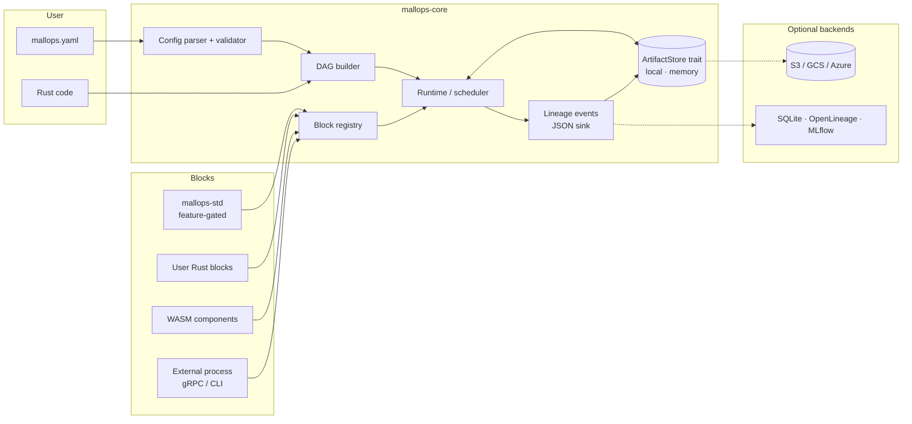
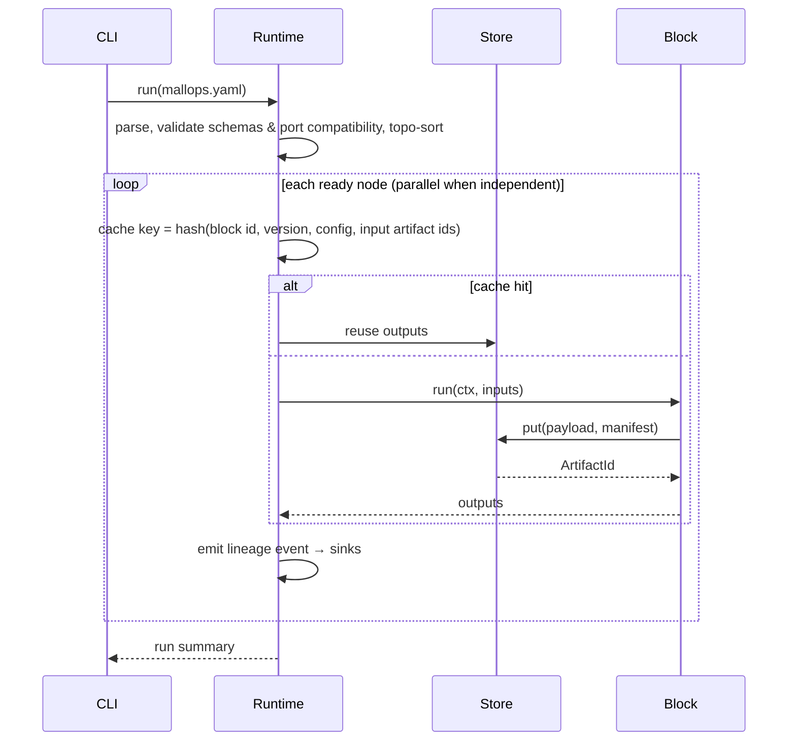
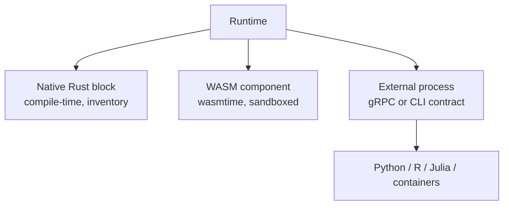
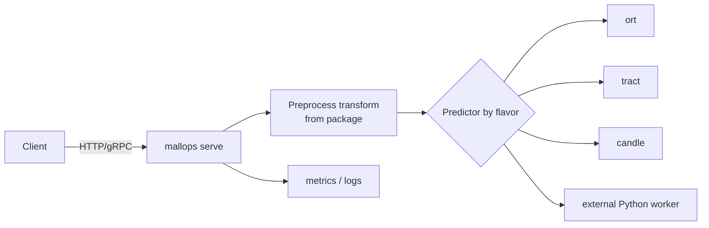
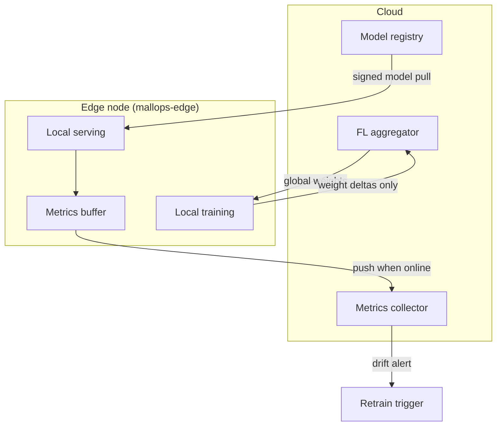

# mallops — Architecture

> Companion to [SPEC.md](SPEC.md). Decisions are recorded in [adr/](adr/README.md).

## 1. Overview



The core knows only three things: **blocks**, **artifacts**, and **the graph** between them. Everything ML-specific lives in blocks.

Store and lineage are not blocks: blocks are *nodes* of the DAG, while store and lineage act on *every edge*. The core owns their **contracts** and a minimal default; every real backend is optional ([ADR-0006](adr/0006-store-and-lineage-contracts.md)).

## 2. Workspace layout

```
mallops/
├── crates/
│   ├── mallops-core/   # traits, artifacts, store & lineage contracts, config, runtime
│   ├── mallops-cli/    # `mallops` binary              (v0.1)
│   ├── mallops-std/    # standard blocks, feature-gated (v0.1)
│   └── mallops-edge/   # edge agent + FL aggregator     (v0.4)
├── docs/
└── examples/
```

Crates are created only when implemented. Splitting `mallops-std` into per-stage crates is deferred until compile times or dependency weight demand it ([ADR-0001](adr/0001-modular-workspace.md)).

| Crate | Depends on | Heavy deps |
|---|---|---|
| `mallops-core` | — | `tokio`, `serde`, `blake3`, `tracing` |
| `mallops-std` | core | per feature: `arrow`, `polars`, `linfa`, `ort`, `axum`, `object_store` (`store-s3`, `store-gcs`, `store-azure`), `rusqlite` (`lineage-sqlite`), … |
| `mallops-cli` | core, std | `clap` |
| `mallops-edge` | core, std (subset) | `tonic` |

## 3. Core abstractions

```rust
/// Static description of a block: identity, I/O ports, config schema.
pub struct BlockSpec {
    pub id: &'static str,            // "std/train.external"
    pub stage: Stage,                // Ingest, Preprocess, Train, …
    pub inputs: Vec<Port>,           // name + accepted kind/formats/flavors
    pub outputs: Vec<Port>,
    pub config_schema: schemars::Schema,
}

#[async_trait]
pub trait Block: Send + Sync {
    fn spec(&self) -> BlockSpec;
    async fn run(&self, ctx: &Context, inputs: Inputs) -> Result<Outputs>;
}

/// Given to each block during execution.
pub struct Context {
    pub run_id: RunId,
    pub workdir: PathBuf,            // scratch dir, also mounted for external blocks
    pub store: Arc<dyn ArtifactStore>,
    pub config: serde_json::Value,   // the block's `with:` section, already validated
    pub span: tracing::Span,
}
// Blocks never touch lineage: the runtime records it around `run()`.

pub struct Artifact {
    pub id: ArtifactId,              // BLAKE3 of manifest + payload
    pub manifest: Manifest,          // kind, format, flavor, signature, metadata, parents
}
```

Serving uses one more trait, implemented by backend crates/plugins and selected by `flavor`:

```rust
#[async_trait]
pub trait Predictor: Send + Sync {
    fn flavors(&self) -> &[&str];                       // e.g. ["onnx"], ["sklearn-pickle"]
    async fn load(&self, pkg: &Artifact, ctx: &Context) -> Result<Box<dyn Loaded>>;
}
```

No ML type appears in core signatures: tensors and dataframes are payload files or plugin-internal types. This is what keeps mallops library-agnostic ([ADR-0004](adr/0004-agnostic-artifacts-and-flavors.md)).

## 4. Execution model



- Scheduler: `tokio` tasks, bounded concurrency (`--jobs`).
- Failure: a failed node cancels its descendants; other branches finish. Re-running resumes from cache.
- Quality gates are blocks that return an error (stop) or a `skip` signal for downstream nodes.

## 5. Plugin model



| Kind | Use when | Isolation | Overhead |
|---|---|---|---|
| Native | Rust, performance critical | none | zero |
| WASM | portable, untrusted, light compute | strong | low |
| External | other languages, GPUs, heavy frameworks | process/container | process spawn + IPC |

The **external CLI contract** is the simplest: mallops writes `inputs.json` (artifact paths + manifests) and `config.json` into the workdir, runs the command, and collects files declared in `outputs.json`. Any language can implement it in a few lines. The gRPC variant adds long-lived workers and streaming. See [ADR-0003](adr/0003-plugins-wasm-and-grpc.md).

## 6. Artifact store and lineage

Two kinds of "storage" exist and must not be confused:

| | Data storage blocks | Artifact store |
|---|---|---|
| What | Persist user data to lakes, DBs, feature stores | Hand artifacts from one block to the next |
| Where in the DAG | A node | Every edge |
| In the core | No (`mallops-std` / plugins) | Contract + `local` and `memory` impls |
| Optional | Yes | The backend is; the mechanism is not |

### 6.1 Artifact store

```rust
#[async_trait]
pub trait ArtifactStore: Send + Sync {
    async fn put(&self, manifest: Manifest, payload: &Path) -> Result<ArtifactId>;
    async fn get(&self, id: &ArtifactId) -> Result<Artifact>;
    /// Materialize the payload locally (no-op for `local`, download for remote).
    async fn fetch(&self, id: &ArtifactId, dest: &Path) -> Result<PathBuf>;
    async fn exists(&self, id: &ArtifactId) -> Result<bool>;
}
```

- Core implementations: `LocalStore` (filesystem, default, `./.mallops`) and `MemoryStore` (ephemeral; tests and throwaway runs).
- Optional: `ObjectStore` adapter over the `object_store` crate (S3, GCS, Azure) behind `mallops-std` features; anything else as a plugin.
- What depends on it: data hand-off between nodes and processes, caching (cache key → output ids), resume after failure, model registry (v0.2).
- Layout: `artifacts/<hash>/…`, `registry/<model>/<version>.json` (v0.2).

### 6.2 Lineage

```rust
pub enum LineageEvent {
    RunStarted { run: RunId, pipeline_hash: Hash, git_commit: Option<String>, host: HostInfo },
    BlockStarted { run: RunId, node: String, block: BlockRef, config_hash: Hash, inputs: Vec<ArtifactId> },
    ArtifactProduced { run: RunId, node: String, artifact: ArtifactId },
    BlockFinished { run: RunId, node: String, status: Status, duration: Duration, cached: bool },
    RunFinished { run: RunId, status: Status },
}

#[async_trait]
pub trait LineageSink: Send + Sync {
    async fn record(&self, event: &LineageEvent) -> Result<()>;
}
```

- The runtime is the only producer: it alone sees the whole graph. Blocks stay unaware of lineage.
- Core sink: `JsonSink`, writing `runs/<run-id>/lineage.json` into the artifact store.
- Optional sinks: SQLite (queryable), OpenLineage (Marquez, DataHub…), MLflow — `mallops-std` features or plugins.
- Zero or more sinks; `lineage: off` disables it. A failing sink logs a warning and never fails the run.
- Caching does **not** depend on lineage: it uses artifact hashes in the store.

## 7. Serving



## 8. Edge and federated learning (v0.4)



- Transport: gRPC (`tonic`) with mTLS; nodes initiate connections (NAT-friendly).
- Aggregation strategies are blocks (FedAvg default); privacy techniques plug in at the aggregator.
- Model weights exchanged in whatever format the flavor defines; the aggregator delegates averaging to a flavor-aware plugin.

## 9. Cross-cutting concerns

| Concern | Choice |
|---|---|
| Errors | `thiserror` in libraries, `anyhow` only in the CLI |
| Logging/tracing | `tracing`; OpenTelemetry exporter behind a feature |
| Config | `serde` + `serde_yaml` + `schemars` |
| Async | `tokio` |
| CLI | `clap` derive |
| Testing | unit tests per crate, integration tests running example pipelines, `insta` snapshots for CLI output |
