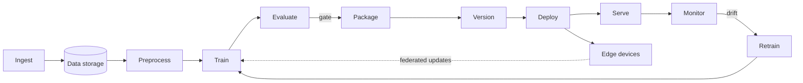

  
  

# mallops

**Modular MLOps in Rust — from data ingestion to edge devices, one block at a time.**

!!! warning "Early stage"
    mallops is in the design phase. The specification and architecture are open for feedback.

## Why mallops

- **Every MLOps step is a block** — ingestion, storage, preprocessing, training, model engineering, evaluation, packaging, versioning, deploy, serving, monitoring, retrain. Add, remove or replace any of them.
- **Bring any model, any library** — ONNX, safetensors, TorchScript, pickle, GGUF, XGBoost, your own format.
- **Three ways to use it** — Rust library, plugins (WASM or external processes in any language), or standalone with YAML and the `mallops` CLI.
- **Edge-ready** — local serving, distributed monitoring and federated learning on devices.
- **Reproducible** — content-addressed artifacts, lineage for every run, cached re-runs.

## Where to start

- [Technical specification](SPEC.md) — what mallops does.
- [Architecture](ARCHITECTURE.md) — how it is built.
- [Decisions](adr/README.md) — why it is built that way.
- [API reference](https://docs.rs/mallops-core) — Rust docs on docs.rs.
